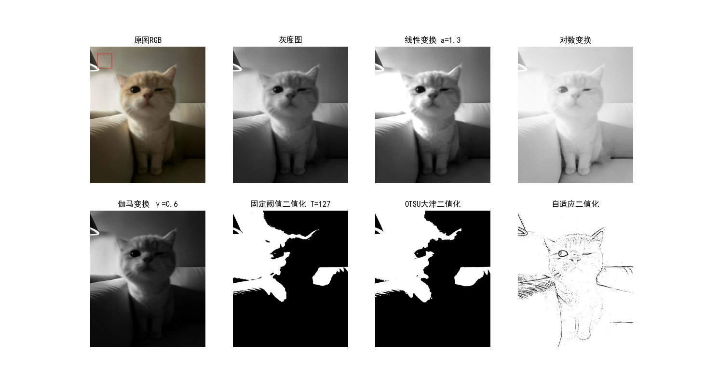
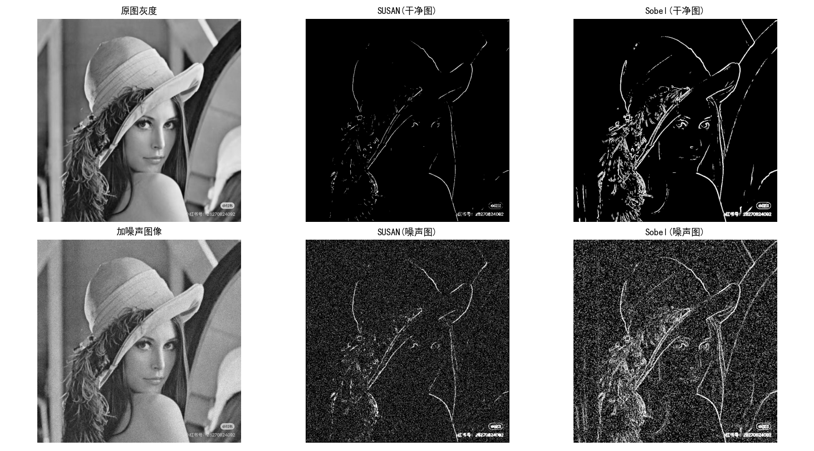
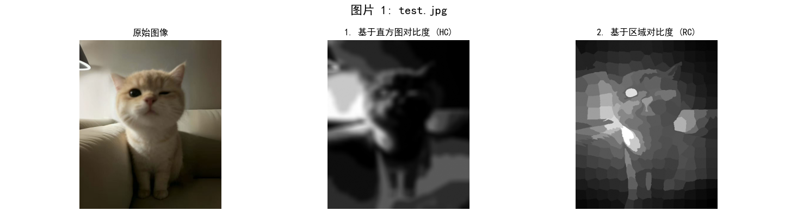
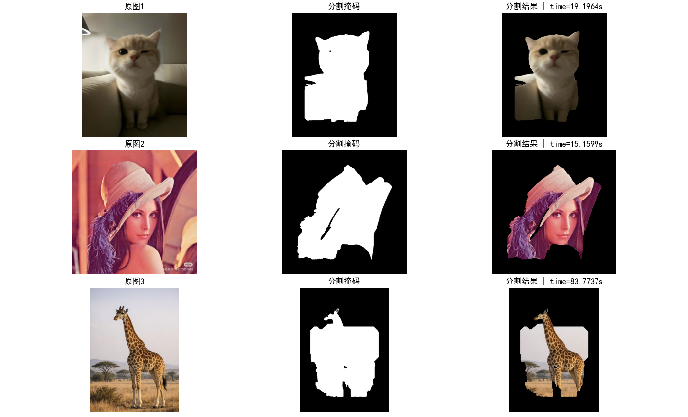

# Computer-Vision

基于 OpenCV / NumPy 的计算机视觉基础算法实验合集，涵盖灰度变换、几何变换、边缘检测、显著性检测与图像分割等经典算法，每个实验均配有完整源码、运行结果图与实验报告。

> 课程实验整理而成，代码结构清晰、注释详细，适合作为数字图像处理的入门学习参考。

## ✨ 实验列表

| 序号 | 实验 | 核心算法 | 脚本 |
| ---- | ---- | ---- | ---- |
| 01 | 灰度变换与二值化处理 | 线性/对数/伽马变换、固定阈值、OTSU、自适应阈值 | [exp01](experiments/exp01_gray_transform_binarization.py) |
| 02 | 图像缩放、算术运算及平移旋转 | 上/下采样、加減乘除、正向平移、旋转 | [exp02](experiments/exp02_geometric_arithmetic_transforms.py) |
| 03 | 边缘检测算法实现 | Roberts、Prewitt（手写卷积实现） | [exp03](experiments/exp03_edge_detection_roberts_prewitt.py) |
| 04 | SUSAN 与索贝尔算子边缘检测 | 37 点圆形模板 SUSAN 算子、Sobel 算子 | [exp04](experiments/exp04_susan_sobel_edge_detection.py) |
| 05 | 显著性检测 | 直方图对比度（HC）、区域对比度（RC） | [exp05](experiments/exp05_saliency_hc_rc.py) |
| 06 | 对比度分布显著性检测 | 多方向 Sobel 梯度对比度分布 | [exp06](experiments/exp06_contrast_distribution_saliency.py) |
| 07 | 基于图搜索的图像分割 | GrabCut（图割/最小割）两轮迭代精修 | [exp07](experiments/exp07_grabcut_image_segmentation.py) |

## 📁 目录结构

```
Computer-Vision/
├── experiments/    # 7 个实验的 Python 源码
├── data/           # 测试图像
├── results/        # 各实验运行结果图
├── reports/        # 实验报告（Word 文档）
├── requirements.txt
└── README.md
```

## 🚀 快速开始

### 环境要求

- Python 3.8+
- 依赖见 [requirements.txt](requirements.txt)

### 安装依赖

```bash
pip install -r requirements.txt
```

### 运行实验

在项目根目录下运行任意实验脚本，例如：

```bash
python experiments/exp01_gray_transform_binarization.py
```

运行后将弹出 Matplotlib 窗口展示各阶段处理结果。

## 🖼️ 部分结果展示

### 灰度变换与二值化（实验 01）



### SUSAN 与 Sobel 边缘检测（实验 04）



### 显著性检测 HC / RC（实验 05）



### GrabCut 图像分割（实验 07）



完整结果图见 [results/](results/) 目录。

## 📄 实验报告

各实验的详细原理推导、实现思路与分析见 [reports/](reports/) 目录下的 Word 文档。

## 🛠️ 技术栈

- **OpenCV** — 图像读取、滤波、阈值分割、GrabCut
- **NumPy** — 手写卷积核、像素级运算（Roberts / Prewitt / SUSAN 均为纯 NumPy 实现）
- **Matplotlib** — 结果可视化
- **scikit-image** — SLIC 超像素分割（区域对比度显著性检测）

## 📖 License

本项目基于 [MIT License](LICENSE) 开源。
